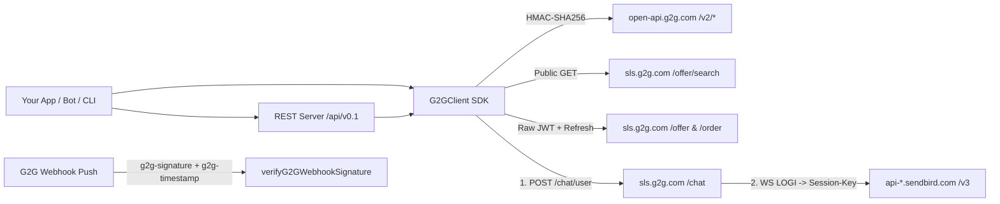

<div align="center">

# `g2g-api`

**Unified TypeScript SDK & Standalone REST API (`v0.1`) for G2G.com**

Official Seller OpenAPI v2 (HMAC-SHA256) · Public Market Scanner · Web Seller Session API (with JWT Auto-Refresh) · Live SendBird Buyer Chat · Verified Webhooks

[](./CHANGELOG.md)
[](https://www.typescriptlang.org/)
[](https://nodejs.org/)
[](./LICENSE)

[Quickstart](#-quickstart) · [Architecture](#-architecture) · [Authentication](#-how-authentication-works) · [Getting Credentials](./docs/CREDENTIALS.md) · [REST API v0.1](#-rest-api-v01-endpoints) · [Examples](./examples)

</div>

---

## Overview

`g2g-api` is a clean, standalone TypeScript library and optional Express REST server (`API v0.1`) covering every interface exposed by **G2G.com**:

| Layer | Base Host | Authentication | Capabilities |
| :--- | :--- | :--- | :--- |
| **1. Official Seller OpenAPI v2** | `https://open-api.g2g.com` | HMAC-SHA256 headers (`g2g-api-key`, `g2g-userid`, `g2g-signature`, `g2g-timestamp`) | Store info, services, brands, products, attributes, pricing, offers, orders, delivery, inventory codes, webhook logs |
| **2. Public Market Scanner** | `https://sls.g2g.com` | None (public) | Live competitor offer discovery, price floor & median summaries, `filter_attr` filtering, pagination |
| **3. Web Seller Session API** | `https://sls.g2g.com` | Raw web JWT (`Authorization` **without** `Bearer `) + auto-refresh on `401` | Create/edit/bulk-update/remove offers (works on normal seller accounts), list seller orders, 3-step delivery workflow (`start_deliver` → `mark_as_delivering` → `delivered_qty`), notifications |
| **4. Live Buyer Chat (SendBird)** | `https://sls.g2g.com/chat` + `sendbird.com` | 2-step bridge: Web JWT → SendBird WS `LOGI` → cached `Session-Key` | List buyer DM channels, read history, create/open DM channels, send messages (REST + WS fallback), mark read |
| **5. Inbound Webhooks** | Your HTTPS server | HMAC-SHA256 (`g2g-signature` + `g2g-timestamp`, ±5 min replay window) | Express middleware + timing-safe signature verification + safe order state classifier |

---

## Architecture



---

## Quickstart

### 1. Install dependencies & build

```bash
git clone https://github.com/lguilhermee/g2g-api.git
cd g2g-api
npm install
npm run build
npm test
```

### 2. Configure credentials

Copy `.env.example` to `.env` and fill in the layers you want to use:

```bash
cp .env.example .env
```

> Need help finding your API keys, User ID, Web JWT, refresh tokens, or webhook secret?
> Follow the step-by-step **[Credentials Guide (`docs/CREDENTIALS.md`)](./docs/CREDENTIALS.md)**.

### 3. Use the TypeScript SDK

```ts
import "dotenv/config";
import { G2GClient, allowsG2GDelivery, classifyG2GOrderState } from "g2g-api";

// 1. Public market scan (no credentials needed)
const market = await G2GClient.summarizeMarket({
  seoTerm: "wow-gold",
  sort: "lowest_price",
  pageSize: 10,
});
console.log("Lowest USD:", market.lowestUsd, "Median USD:", market.medianUsd);

// 2. Authenticated client from environment variables
const client = G2GClient.fromEnv();

// Official OpenAPI v2
const store = await client.getStore();
console.log("Store:", store.payload);

// Web Seller API (auto-refreshes JWT on 401 when refresh tokens are set)
const orders = await client.listMyWebOrders({ page: 1, pageSize: 10 });
const offers = await client.listMyWebOffers(1, 20);

// Live Buyer Chat (SendBird bridge)
const channels = await client.listChatChannels({ limit: 20, onlyDms: true });
if (channels[0]) {
  const messages = await client.getChatMessages(channels[0].channelUrl, 20);
  console.log(messages);
}
```

### 4. Or run the standalone REST Server (`v0.1`)

```bash
npm run dev:server
# [g2g-api v0.1] REST server listening on http://localhost:4080/api/v0.1
```

---

## How Authentication Works

Full protocol details, diagrams, and edge cases are documented in **[`docs/AUTHENTICATION.md`](./docs/AUTHENTICATION.md)**. Summary:

### 1. Official Seller OpenAPI v2 (`HMAC-SHA256`)

Every request to `https://open-api.g2g.com/v2/*` is signed using:

```text
canonical  = urlPathWithoutQuery + apiKey + userId + timestampMs
signature  = hex(HMAC_SHA256(key = apiSecret, data = canonical))
```

Required headers:
- `g2g-api-key`: Your Seller OpenAPI key
- `g2g-userid`: Your numeric G2G account user ID
- `g2g-timestamp`: 13-digit Unix timestamp in milliseconds
- `g2g-signature`: Lowercase hex HMAC-SHA256 digest

> **Gotcha:** Strip query strings (`?language=en`) from `urlPath` before computing `canonical`. The SDK helper `signG2GOpenApiRequest()` handles this automatically.

### 2. Web Seller Session API (`Raw JWT + Auto-Refresh`)

Requests to `https://sls.g2g.com` require your web session access JWT in the `Authorization` header **without** a `Bearer ` prefix:

```http
Authorization: eyJhbGciOi...
Origin: https://www.g2g.com
Referer: https://www.g2g.com/
```

When a request receives `HTTP 401`, `G2GClient` automatically calls `POST https://sls.g2g.com/user/refresh_access` using `user_id`, `refresh_token`, `active_device_token`, and `long_lived_token`, retries the failed request once, and fires your `onTokensRefreshed` callback so you can persist rotated tokens.

### 3. Live Buyer Chat (`SendBird Bridge`)

G2G powers its chat using SendBird (`App ID: 34201740-152E-401E-AD8F-5C72EEABA386`):

1. `POST https://sls.g2g.com/chat/user` with `{ "user_id": "<sellerId>" }` returns a short-lived SendBird `session_token`.
2. `G2GClient` opens a WebSocket handshake to `wss://ws-34201740-152E-401E-AD8F-5C72EEABA386.sendbird.com/`, parses the `LOGI{...}` frame, and extracts `key` (the SendBird `Session-Key`).
3. Subsequent REST calls to `https://api-34201740-152E-401E-AD8F-5C72EEABA386.sendbird.com/v3/*` authenticate with `Session-Key: <key>` (cached 25 min, auto-refreshed on `401` / `400302` / `400303`).
4. Sending messages uses SendBird v3 REST and automatically falls back to a WebSocket `MESG` frame if needed.

### 4. Inbound Webhook Verification (`HMAC-SHA256`)

```text
canonical  = registeredWebhookUrl + userId + timestampHeader
expected   = HMAC_SHA256(key = webhookSecret, data = canonical)
```

`verifyG2GWebhookSignature()` enforces:
- Valid 13-digit millisecond timestamp within ±5 minutes (replay protection)
- 64-character hex digest
- Constant-time `crypto.timingSafeEqual` verification

---

## 3-Step Web Order Delivery Flow

G2G's seller web dashboard transitions orders through three explicit endpoints (all exposed on `G2GClient`):

1. **Step 1 — View Delivery Details** (`to_deliver` → `start_deliver`):
   `await client.startWebDelivery(orderItemId)` (`PUT /order/item/:itemId/start_deliver`)
2. **Step 2 — Start Delivery** (`start_deliver` → `delivering`, notifies buyer & extends cancel timer +30 min):
   `await client.markWebOrderDelivering(orderItemId)` (`PUT /order/item/:itemId/mark_as_delivering`)
   *(Or call `await client.advanceWebDeliveryToDelivering(orderItemId)` to perform Steps 1 & 2 idempotently.)*
3. **Step 3 — Confirm Delivered Quantity**:
   `await client.updateWebDeliveredQty(orderItemId, qty)` (`PUT /order/item/:itemId/delivered_qty`)

Always check `allowsG2GDelivery(orderPayload)` before delivering so cancelled, refunded, disputed, or unpaid orders are never fulfilled.

---

## REST API v0.1 Endpoints

When running `npm run dev:server` (or mounting `createG2GServer()`), the following routes are exposed under `/api/v0.1`:

| Method | Path | Description |
| :--- | :--- | :--- |
| `GET` | `/api/v0.1/health` | Health check and API version (`0.1`) |
| `POST` | `/api/v0.1/diagnostics` | Verify OpenAPI v2 + Web Seller credentials |
| `GET` | `/api/v0.1/market/search?seoTerm=...` | Public competitor market scan + lowest/median USD |
| `GET` | `/api/v0.1/store` | OpenAPI v2 seller store info |
| `GET` | `/api/v0.1/services` | OpenAPI v2 catalog services |
| `GET` | `/api/v0.1/services/:serviceId/brands` | OpenAPI v2 brands for a service |
| `GET` | `/api/v0.1/products?serviceId=...&brandId=...` | OpenAPI v2 products |
| `GET` | `/api/v0.1/offers/:offerId` | OpenAPI v2 offer detail |
| `GET` | `/api/v0.1/web/offers` | List seller's live web offers |
| `GET` | `/api/v0.1/web/orders` | List seller's web orders |
| `POST` | `/api/v0.1/web/orders/:itemId/start-deliver` | Idempotently advance delivery to `delivering` |
| `POST` | `/api/v0.1/web/orders/:itemId/deliver` | Submit delivered quantity (`{ "qty": 1 }`) |
| `GET` | `/api/v0.1/chat/channels` | List live buyer SendBird DM channels |
| `GET` | `/api/v0.1/chat/channels/:channelUrl/messages` | Fetch messages for a chat channel |
| `POST` | `/api/v0.1/chat/channels/:channelUrl/messages` | Send a live buyer chat message (`{ "message": "..." }`) |
| `POST` | `/api/v0.1/webhook` | HMAC-verified inbound G2G webhook receiver |

Set `SERVER_API_TOKEN` in `.env` to protect all non-webhook endpoints with `Authorization: Bearer <SERVER_API_TOKEN>`.

---

## Examples

| Script | Description | Command |
| :--- | :--- | :--- |
| [`examples/market-scan.ts`](./examples/market-scan.ts) | Public competitor scan (zero auth) | `npx tsx examples/market-scan.ts wow-gold` |
| [`examples/offers-and-orders.ts`](./examples/offers-and-orders.ts) | Check OpenAPI store, web offers, and order states | `npx tsx examples/offers-and-orders.ts` |
| [`examples/live-chat.ts`](./examples/live-chat.ts) | List buyer DM channels and read messages | `npx tsx examples/live-chat.ts` |
| [`examples/webhook-server.ts`](./examples/webhook-server.ts) | Run the REST v0.1 server + webhook handler | `npx tsx examples/webhook-server.ts` |

---

## Disclaimer

This is an **unofficial, community-maintained** project and is not affiliated with, endorsed by, or sponsored by G2G.com. Use of unofficial web-session or chat endpoints may be subject to G2G's Terms of Service and rate limits — use responsibly and at your own risk. Never commit `.env` files or session tokens to source control.

---

## License

[MIT](./LICENSE)
